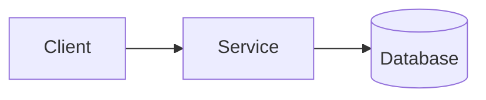

# Architecture: <Title>

## Context
<What problem are we solving? What constraints exist?>

## Decisions
<Key architectural decisions and rationale>

## Components
<List and describe each component>

## Diagram

## Trade-offs
| Option | Pros | Cons | Decision |
| ------ | ---- | ---- | -------- |
|        |      |      |          |

## Future Considerations
<Known limitations, planned evolution>

## Related
- <link>
